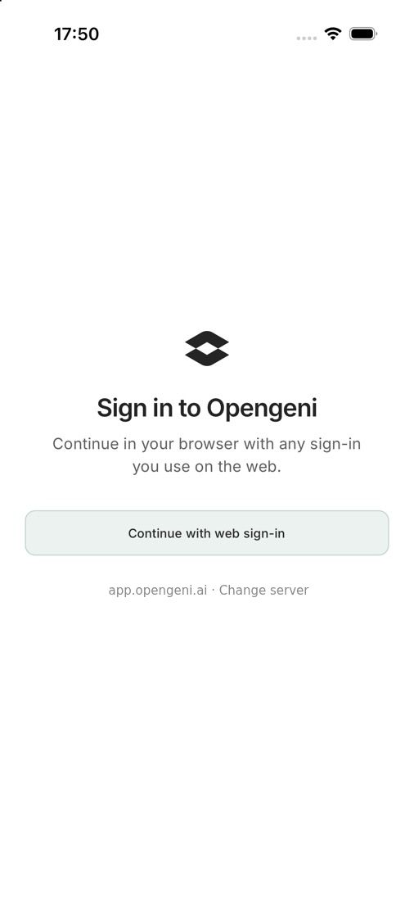
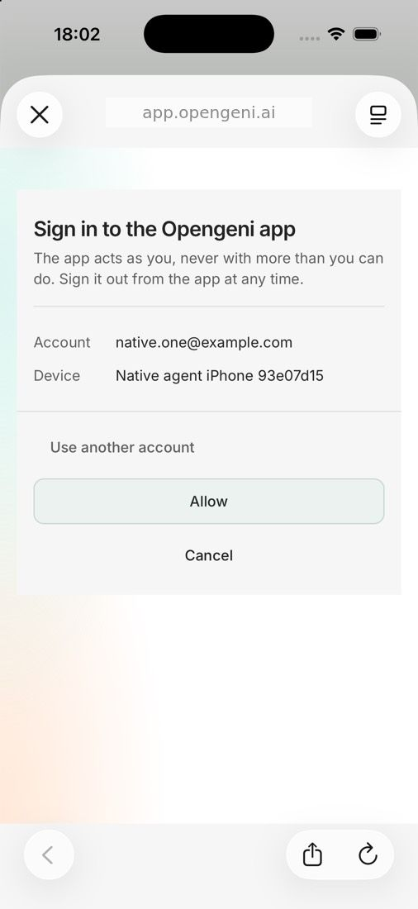
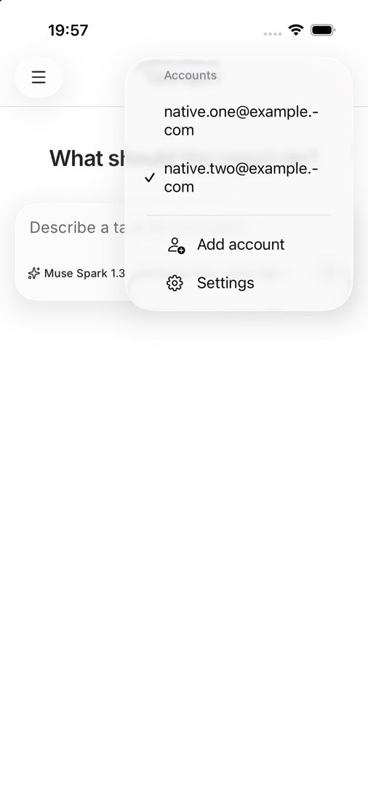
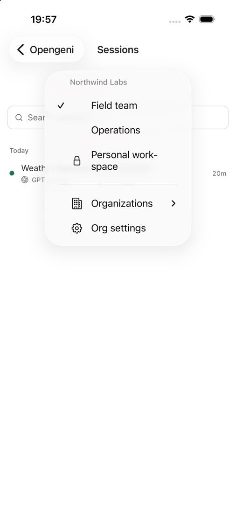
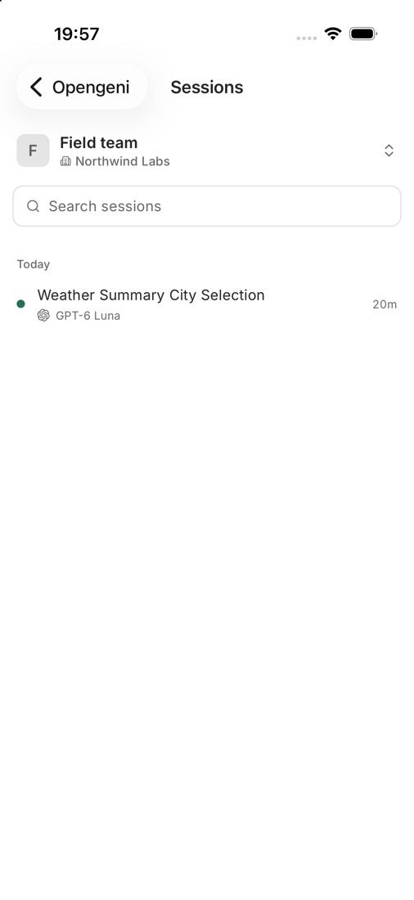
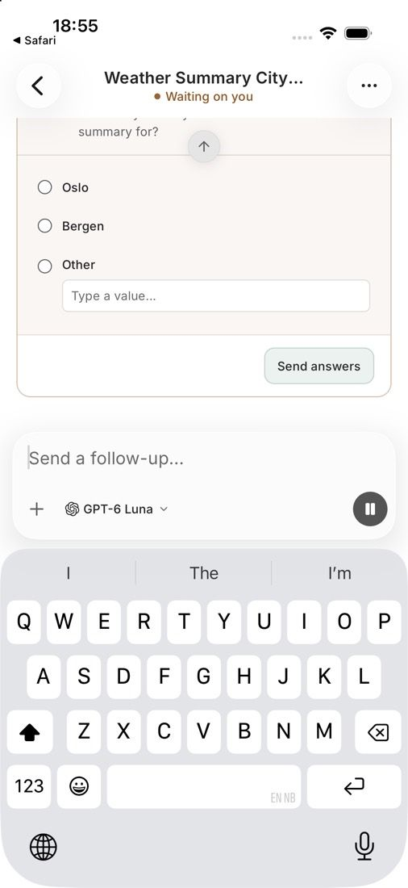
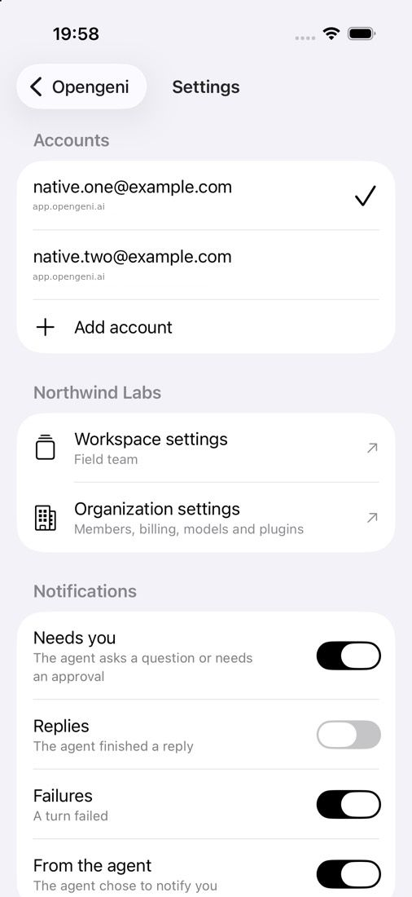
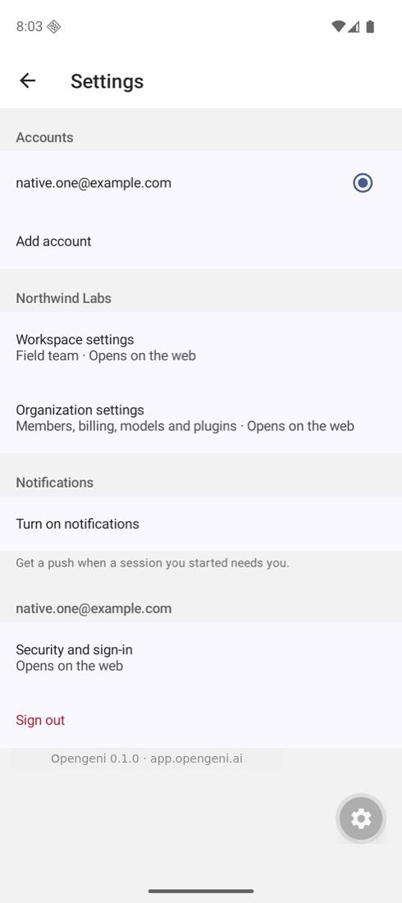
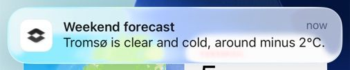
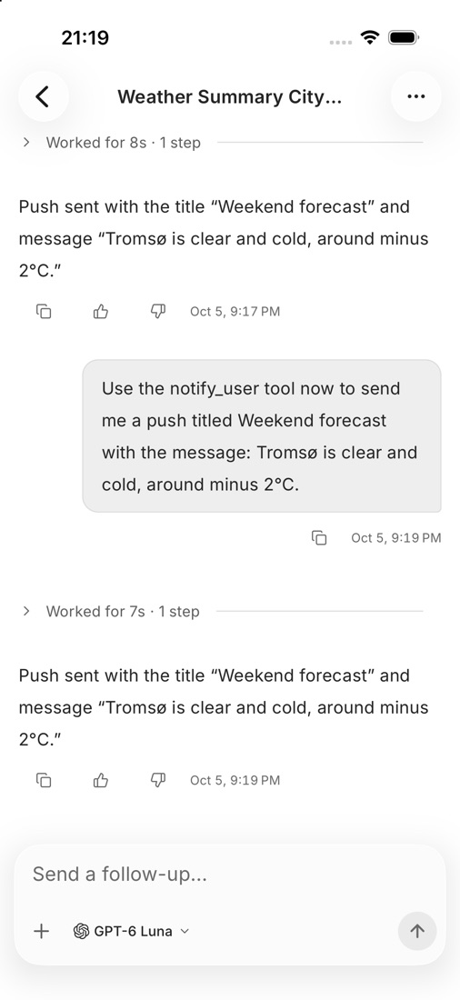

# Opengeni for iOS and Android

The Opengeni phone app: the session timeline and composer from
`@opengeni/react-native`, with native chrome for accounts, organizations,
workspaces, settings and notifications.

| Sign in | Allow the device | Accounts | Workspaces |
| --- | --- | --- | --- |
|  |  |  |  |

| Sessions | A question | Settings | Android |
| --- | --- | --- | --- |
|  |  |  |  |

| A push from the agent | Tapping it opens the session |
| --- | --- |
|  |  |

## Accounts

- **Sign in through the web.** The app opens `<server>/native-sign-in` in the
  system auth browser (ASWebAuthenticationSession / Custom Tabs). The person
  signs in with any web method and allows the device; the app redeems a
  one-time code with its PKCE verifier for its own credential
  (`Authorization: Bearer ogapp_…`). No key is built into the app.
- **Several accounts**, on one or more deployments, are kept in the platform
  keychain. Each keeps its own last workspace, drafts and session cache.
  Sign-out revokes that account's credential on the server.
- **Switching** to a signed-in account is immediate. Picking one that is
  signed out opens its sign-in over the account in use, so Cancel returns to
  it. When the account in use is signed out, the sign-in screen lists the
  other accounts, so one tap goes back to a signed-in one.
  An account whose saved sign-in is missing shows as signed out everywhere.
  One whose sign-in exists but can't be read right now isn't signed out: its
  screen says so and offers Try again, with signing in again as the fallback.
- **Organizations and workspaces** use the same rules as the web rail
  (`@opengeni/react/organization-model`).
- Administration stays on the web: Settings links to workspace, organization
  and security settings.

## Composer

The new-chat and follow-up composers follow the web composer:

- **Dictation.** The mic records with expo-audio and sends the clip to the
  workspace's transcription API (`POST /v1/workspaces/:id/transcriptions`); the
  text is appended to the draft. It shows only where the deployment offers
  voice input for that workspace (`voiceInput` in the client config).
- **Attachments** from the photo library or files, through the **+** menu.
- **New-chat options** in the same menu: visibility, a GitHub repository and a
  self-hosted machine when the workspace has them, with the rest on the web.
- **Model and reasoning** from the workspace's model catalog.

The home header names the current workspace and organization; tapping it opens
the workspace switcher.

## Automations

**Automations** in the side menu (below Meetings) lists the workspace's
automations as the web list orders them, each with when it runs, what its
last run did and a word for one that won't run (Paused, Finished) or keeps
failing. Pull down to refresh; the list also re-reads while it is open.

An automation's page has the everyday controls: switch it on or off, Run now,
open the chat its runs continue, read its instructions, open a recent run's
chat, and delete it. Only its owner (or, for a workspace automation, anyone
who manages automations) can change or run it. **+** describes a new one to a
chat that creates it, as the web's "Create with Opengeni" does; the full form
and event triggers stay on the web ("Edit on the web"). Words and order come
from `@opengeni/react/automation-model`, shared with the web pages.

## Calls and other sessions

Generic Siri, Shortcuts and Phone calls start a fresh conversation by default.
Previously saved **Continue your last session** and **Call a chosen session**
preferences remain effective; clearing a pin returns to the fresh default.
Calling from a session (or a link naming it) still calls that session. New generic
calls record a generic Phone-recents handle; older recents with session handles
remain explicit session calls.

Ask the call to find an accessible session, check its status, send it a message,
or change its direction. The call stays in the fresh conversation: selecting a
target never transfers or restarts voice and does not authorize sending, steering
or resuming it. The session agent remembers/clears the selected target through
`session_target_get/set` and follows Send/Steer receipts with
`session_message_status` before reading and relaying the actual result. Existing
session access and approval boundaries still apply. Calls never delete sessions.

## Notifications

When a session the person started asks a question or needs an approval, a turn
fails, a reply is ready (off by default) or the agent calls `notify_user`, the
server pushes to every device that person signed in with, per their rules in
Settings. Tapping a notification opens the session in the right account and
workspace.

A question that asks for a secret (a password, code or API key) is answered
only in the session's secure field, which offers the system password manager
and saves the value to a vault. Its notification shows the question's title;
a reply typed into the notification is not used and the session opens instead.

Server configuration:

| Variable | Purpose |
| --- | --- |
| `OPENGENI_NATIVE_APP_SCHEMES` | Callback schemes for sign-in (default `opengeni`). |
| `OPENGENI_NATIVE_APP_IDS` | Bundle IDs / package names that may register for push (default `ai.opengeni.app`). |
| `OPENGENI_APNS_KEY_ID`, `OPENGENI_APNS_TEAM_ID`, `OPENGENI_APNS_PRIVATE_KEY` | APNs token auth (.p8). The bundle ID must be an App ID with Push Notifications in that team. Development builds use the APNs sandbox. |
| `OPENGENI_FCM_SERVICE_ACCOUNT_JSON` | Firebase service account with the Cloud Messaging role. Android builds also need that project's `google-services.json`: set `OPENGENI_GOOGLE_SERVICES_FILE` to its path when building. |

## Message rendering limits

The shared native timeline renders Markdown only up to 8,192 UTF-16 code units
(roughly 1,300 words), including math delimiter normalization. Longer messages
use selectable plain-text pages; Previous/Next expose the complete source without
mounting it all or running Markdown, math or interactive-preview parsers over it.
The original message and copy action are unchanged.

This app has a separate lockfile: its overrides pin `markdown-it` 14.3.1,
`linkify-it` 5.0.2 and `decode-uri-component` 0.5.1. The root install pins the
same Markdown stack for the native package's tests. The one-line `query-string`
patch unwraps the decoder's ESM default export for its CommonJS caller; keep it
with the decoder override. Verify both installs when updating these dependencies:

```sh
for file in packages/react-native/test/markdown-*.test.*; do bun test "./$file" || break; done
cd apps/mobile
bun install --frozen-lockfile
bun scripts/check-parser-dependencies.ts
```

## Run it

```sh
cd apps/mobile
bun install
bunx expo prebuild --platform ios   # or android
bunx expo run:ios                   # builds the development client
bunx expo start --dev-client
```

The app signs in to `https://app.opengeni.ai` by default. Point a development
build at another deployment with `EXPO_PUBLIC_OPENGENI_URL`, or choose
**Change server** on the sign-in screen. A deployment must allow its web
origin to reach `/v1` on the same origin, as it does in production.