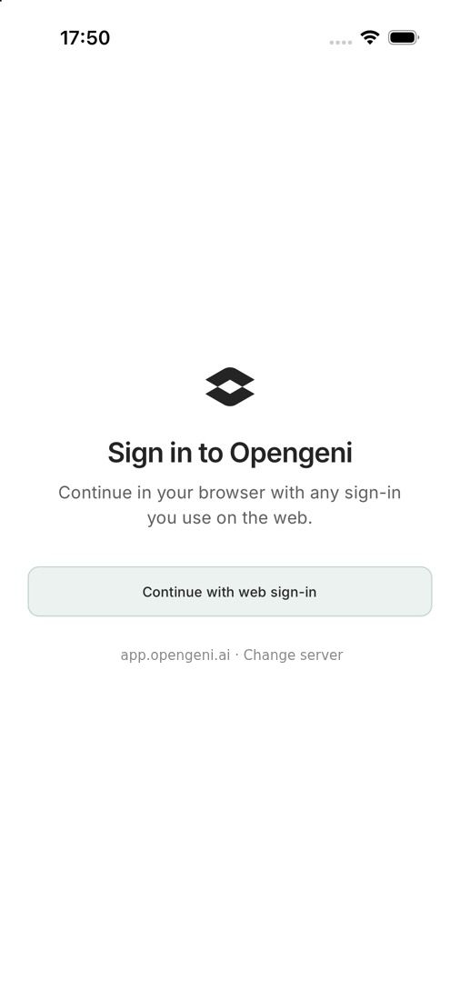
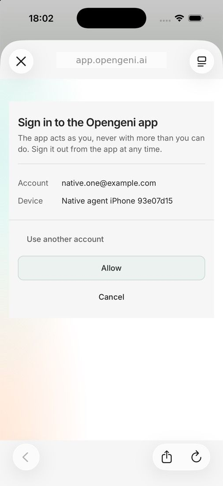
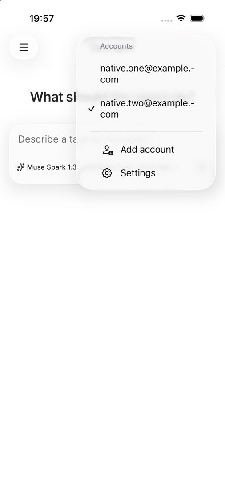
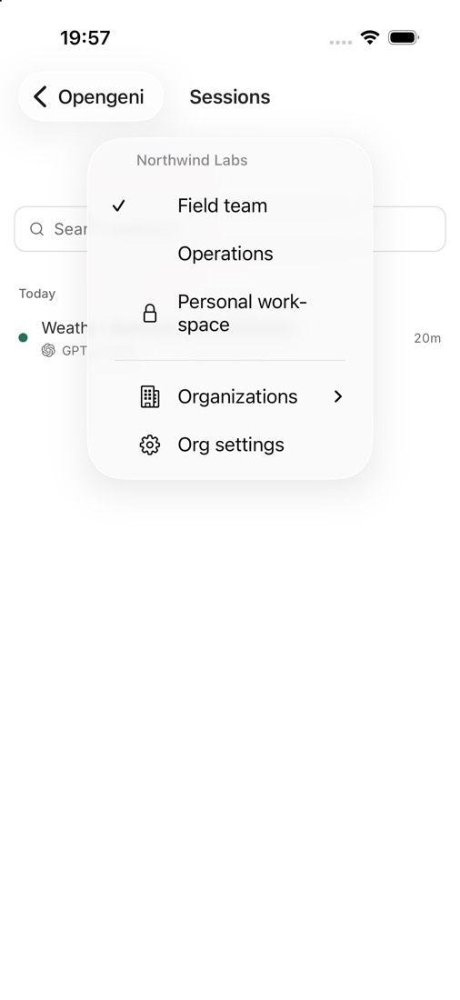
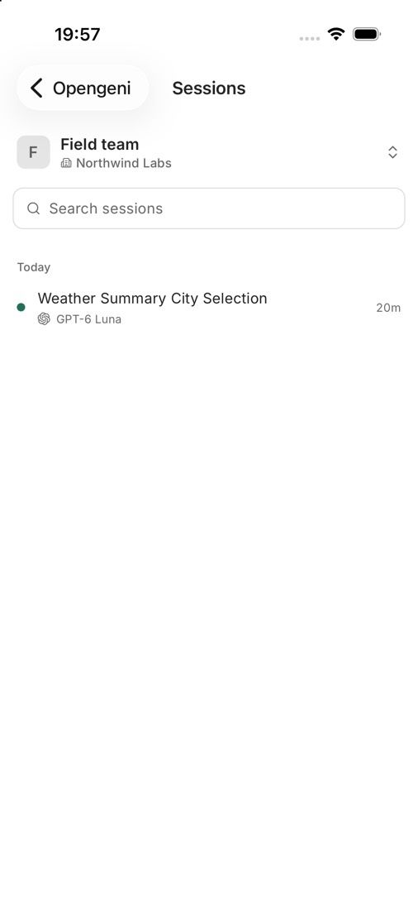
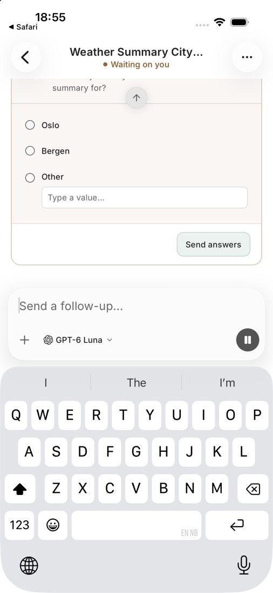
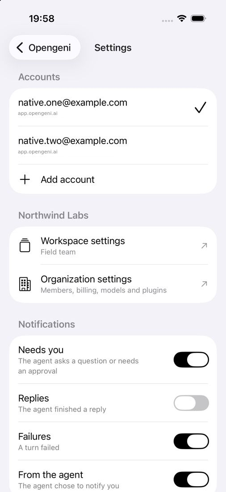
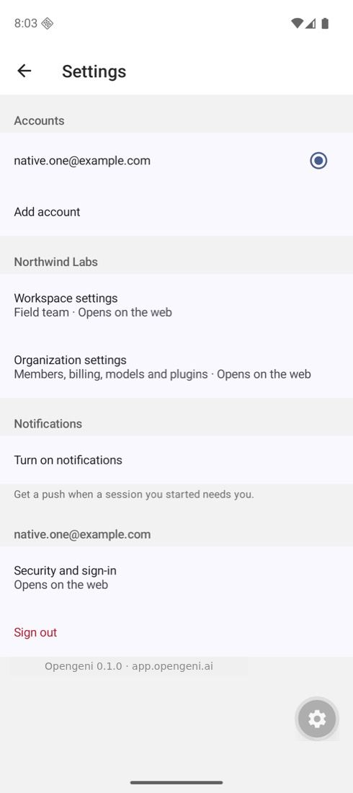
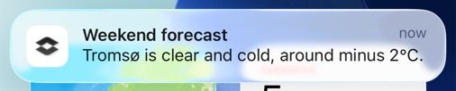
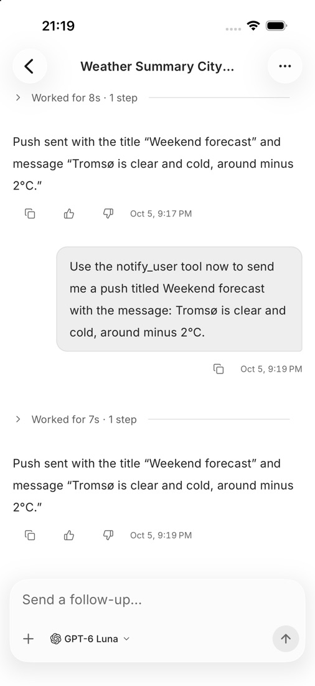

# Opengeni for iOS and Android

The Opengeni phone app: the session timeline and composer from
`@opengeni/react-native`, with native chrome for accounts, organizations,
workspaces, settings and notifications.

| Sign in | Allow the device | Accounts | Workspaces |
| --- | --- | --- | --- |
|  |  |  |  |

| Sessions | A question | Settings | Android |
| --- | --- | --- | --- |
|  |  |  |  |

| A push from the agent | Tapping it opens the session |
| --- | --- |
|  |  |

## Accounts

- **Sign in through the web.** The app opens `<server>/native-sign-in` in the
  system auth browser (ASWebAuthenticationSession / Custom Tabs). The person
  signs in with any web method and allows the device; the app redeems a
  one-time code with its PKCE verifier for its own credential
  (`Authorization: Bearer ogapp_…`). No key is built into the app.
- **Several accounts**, on one or more deployments, are kept in the platform
  keychain. Each keeps its own last workspace, drafts and session cache.
  Sign-out revokes that account's credential on the server.
- **Switching** to a signed-in account is immediate. Picking one that is
  signed out opens its sign-in over the account in use, so Cancel returns to
  it. When the account in use is signed out, the sign-in screen lists the
  other accounts, so one tap goes back to a signed-in one.
  An account whose saved sign-in is missing shows as signed out everywhere.
  One whose sign-in exists but can't be read right now isn't signed out: its
  screen says so and offers Try again, with signing in again as the fallback.
- **Organizations and workspaces** use the same rules as the web rail
  (`@opengeni/react/organization-model`).
- Administration stays on the web: Settings links to workspace, organization
  and security settings.

## Composer

The new-chat and follow-up composers follow the web composer:

- **Dictation.** The mic records with expo-audio and sends the clip to the
  workspace's transcription API (`POST /v1/workspaces/:id/transcriptions`); the
  text is appended to the draft. It shows only where the deployment offers
  voice input for that workspace (`voiceInput` in the client config).
- **Attachments** through the **+** menu: photos and videos from the library
  or the camera, and files. Each file streams from disk to storage with
  Expo's native upload task, showing its progress, so a long video never has
  to fit in memory; library videos keep their original file (often HEVC in a
  `.MOV`). The agent gets them in its sandbox like files uploaded on the web.
- **New-chat options** in the same menu: visibility, a GitHub repository and a
  self-hosted machine when the workspace has them, with the rest on the web.
- **Model and reasoning** from the workspace's model catalog.

The home header names the current workspace and organization; tapping it opens
the workspace switcher.

## Navigation

A rounded bar at the bottom (the content ends above it) moves between **Chats** (Home), **Artifacts**,
**Meetings** and **Inbox** (with a count of the questions and approvals
waiting on you). Home stays at the bottom of the stack and
the other places swap in place above it, so switching never grows the stack.
The chats menu opens from the header's menu button or, on iOS, with a swipe
right from the left edge of any of these places.

The chats menu also shows the workspace's sidebar links, as the web rail does
above the chats: groups as headings, app links (opened in the app viewer at
their page), outside links (opened in the browser) and live lists such as
Pinned apps (at most 3 apps each). They're changed on the web or by an agent;
see [Sidebar layout](../../docs/sidebar-layout.md#clients).

## Artifacts

**Artifacts** lists the workspace's Sites, documents, presentations,
spreadsheets, images and files, newest change first, as large cards with a
preview: a Site's page drawn once per version at a desktop width with its own
scripts (in an incognito web view with no bridge that can't call for data),
captured and cached on the device; a picture of a document's, spreadsheet's or presentation's first
page, sheet or slide; an image's own pixels; the type glyph otherwise, and for a
page that draws nothing. Search and type chips filter it; pull down to refresh.

Tapping a card opens the viewer. Sites and editors show in the web app's
chromeless pages (`/native-view/…`), signed in from the device session through
`POST /v1/native-app/web-session`, so a Site's data and the editors work as on
the web. Images open zoomable on iOS. On iOS, PDFs, text and media draw in
place (without scripts); other files open outside the app. The header has Share and the
web library's menu: Open chat, Pin, Duplicate (Sites), Copy link, Download in
the original format (HTML, the file itself, XLSX), and Delete… for documents,
spreadsheets and presentations. An artifact linked on its own line in a chat
is a card that opens the same viewer.

## Automations

**Automations** in the side menu lists the workspace's
automations as the web list orders them, each with when it runs, what its
last run did and a word for one that won't run (Paused, Finished) or keeps
failing. Pull down to refresh; the list also re-reads while it is open.

An automation's page has the everyday controls: switch it on or off, Run now,
open the chat its runs continue, read its instructions, open a recent run's
chat, and delete it. Only its owner (or, for a workspace automation, anyone
who manages automations) can change or run it. **+** describes a new one to a
chat that creates it, as the web's "Create with Opengeni" does; the full form
and event triggers stay on the web ("Edit on the web"). Words and order come
from `@opengeni/react/automation-model`, shared with the web pages.

## Calls and other sessions

Generic Siri, Shortcuts and Phone calls start a fresh conversation by default.
Previously saved **Continue your last session** and **Call a chosen session**
preferences remain effective; clearing a pin returns to the fresh default.
Calling from a session (or a link naming it) still calls that session. New generic
calls record a generic Phone-recents handle; older recents with session handles
remain explicit session calls.

Ask the call to find an accessible session, check its status, send it a message,
or change its direction. The call stays in the fresh conversation: selecting a
target never transfers or restarts voice and does not authorize sending, steering
or resuming it. The session agent remembers/clears the selected target through
`session_target_get/set` and follows Send/Steer receipts with
`session_message_status` before reading and relaying the actual result. Existing
session access and approval boundaries still apply. Calls never delete sessions.

## Notifications

When a session the person started asks a question or needs an approval, a turn
fails, a reply is ready (off by default) or the agent calls `notify_user`, the
server pushes to every device that person signed in with, per their rules in
Settings. Tapping a notification opens the session in the right account and
workspace.

A question that asks for a secret (a password, code or API key) is answered
only in the session's secure field, which offers the system password manager
and saves the value to a vault. Its notification shows the question's title;
a reply typed into the notification is not used and the session opens instead.

Server configuration:

| Variable | Purpose |
| --- | --- |
| `OPENGENI_NATIVE_APP_SCHEMES` | Callback schemes for sign-in (default `opengeni`). |
| `OPENGENI_NATIVE_APP_IDS` | Bundle IDs / package names that may register for push (default `ai.opengeni.app`). |
| `OPENGENI_APNS_KEY_ID`, `OPENGENI_APNS_TEAM_ID`, `OPENGENI_APNS_PRIVATE_KEY` | APNs token auth (.p8). The bundle ID must be an App ID with Push Notifications in that team. Development builds use the APNs sandbox. |
| `OPENGENI_FCM_SERVICE_ACCOUNT_JSON` | Firebase service account with the Cloud Messaging role. Android builds also need that project's `google-services.json`: set `OPENGENI_GOOGLE_SERVICES_FILE` to its path when building. |

A deployment refuses a push registration it could never deliver: an app ID not in
`OPENGENI_NATIVE_APP_IDS`, or a platform without credentials. Settings then says
the server isn't set up to send notifications to this app; the API's error
message names the refused app ID. The app reports its APNs environment from the build's signing
profile, so a release build installed from Xcode registers for the sandbox.

## Message rendering limits

The shared native timeline never gives one Markdown parse more than 8,192 UTF-16
code units (roughly 1,300 words), including math delimiter normalization. A longer
message is cut into chunks of about 4,096 where markdown-it's own block parser
starts a top-level block (or, in a list longer than one chunk, an item). The parser
that cuts sees display math as the one block the math parser draws, so each chunk
parses to the same blocks a single parse would give, and a fence is code or a
preview as on a single parse. The exceptions come from the math pass, which tracks
code fences by a simpler rule than markdown-it and splits lines only at LF: in a
message with math where the two disagree (a list-item fence closer it reads as an
opener, lone-CR line endings), a chunk can be math-normalized differently from a
single parse, which changes that math and, rarely, the block around it. Each chunk
is math-normalized and parsed on its own, so the inline work grows linearly. The
block pass over the whole message is linear and runs when the text changes; while a
message streams, only its last blocks are block-parsed again, and unchanged chunks
are not prepared or parsed again. A top-level code fence too long to share a chunk
is drawn directly: an `opengeni-html` / `opengeni-site` preview of any size loads in
its web view, and any other code block over one chunk uses plain-text pages. A long
message mounts one chunk-sized slice per frame. Link reference definitions only
resolve within their own chunk, and an ordered list whose items are all numbered
`1.` restarts at 1 after a cut.

Messages over 65,536 code units (roughly 10,000 words), and a single text block
longer than one chunk, use selectable plain-text pages; Previous/Next expose the
complete source without mounting it all or running Markdown, math or
interactive-preview parsers over it. The original message and copy action are
unchanged.

This app has a separate lockfile: its overrides pin `markdown-it` 14.3.1,
`linkify-it` 5.0.2 and `decode-uri-component` 0.5.1. The root install pins the
same Markdown stack for the native package's tests. The one-line `query-string`
patch unwraps the decoder's ESM default export for its CommonJS caller; keep it
with the decoder override. Verify both installs when updating these dependencies:

```sh
for file in packages/react-native/test/markdown-*.test.*; do bun test "./$file" || break; done
cd apps/mobile
bun install --frozen-lockfile
bun scripts/check-parser-dependencies.ts
```

## Run it

```sh
cd apps/mobile
bun install
bunx expo prebuild --platform ios   # or android
bunx expo run:ios                   # builds the development client
bunx expo start --dev-client
```

The app signs in to `https://app.opengeni.ai` by default. Point a development
build at another deployment with `EXPO_PUBLIC_OPENGENI_URL`, or choose
**Change server** on the sign-in screen. A deployment must allow its web
origin to reach `/v1` on the same origin, as it does in production.

## Build for the iOS App Store

Build on a Mac with a version of Xcode and the iOS SDK accepted by App Store
Connect, Node, CocoaPods, and the Bun version in `.bun-version`. Use a clean
checkout of the exact source revision to release. The native project is
generated; there is no EAS or Fastlane dependency.

```sh
# From the repository root:
bun install --frozen-lockfile --filter '@opengeni/react-native'
cd apps/mobile
bun install --frozen-lockfile

# Set in the build shell (no signing secrets in the Expo config):
export OPENGENI_IOS_APP_STORE=1
export OPENGENI_IOS_APPLE_TEAM_ID='<distribution-team-id>'
export OPENGENI_IOS_BUILD_NUMBER='<unused-positive-build-number>'
export EXPO_PUBLIC_OPENGENI_URL=https://app.opengeni.ai
CI=1 bun run prebuild:ios:store
(cd ios && pod install)

# Archive, without uploading. Use a fresh path for each archive.
xcodebuild -workspace ios/Opengeni.xcworkspace -scheme Opengeni \
  -configuration Release -destination 'generic/platform=iOS' \
  -archivePath "$PWD/Opengeni.xcarchive" archive
```

The marketing version is `expo.version` in `app.json`. Choose a fresh build
number for every App Store upload; prebuild applies it to both the app and
the embedded control. The App Store profile uses `ai.opengeni.ios` with Push
Notifications and Time Sensitive Notifications, and `ai.opengeni.ios.CallControl`
as a separate App ID without those capabilities. The development defaults and
Android package are unchanged. Use the same team for both targets. Export the
archive locally using Xcode's App Store Connect distribution
option, or `xcodebuild -exportArchive` with an `app-store-connect` export
options plist and the appropriate signing assets for both IDs.

Before upload, verify both signed bundle IDs, team IDs, matching versions, and
production `aps-environment` on the main app in the exported binary. Inspect
the generated Xcode privacy report from the archive (including SDK manifests);
the required-reason declarations do not substitute for App Store Connect's
data collection and tracking answers. Run the Release app in the simulator
without Metro, then on a physical device verify real sign-in, notifications,
and locked-device incoming calls. For production APNs delivery, the public
server needs `ai.opengeni.ios` in `OPENGENI_NATIVE_APP_IDS` alongside any
existing app IDs, and APNs credentials for the distribution team (see
Notifications). The server has one APNs credential set: don't replace it if
that would break another iOS app served by the same deployment.

## Privacy and account controls on iOS

- **Hosted pages.** Every deployment page the iOS app opens itself (Settings
  links, the organization row, Open on the web, chats and artifacts shown in a
  web view) carries `client=ios`, so the hosted pages show their in-app
  context without purchase prompts. It is added where the app opens the page
  (`markHostedUrl` and `hostedUrl` in `src/web-links.ts`), never in `webUrl`,
  which also builds the app's own API requests and the links people share.
- **AI providers.** Before the first Send, call, dictation, recording or audio
  import, the app reads `GET /v1/me/ai-processing-consent`. When it is
  required, the server's disclosure (its title, text, providers and privacy
  link) is shown, and nothing is sent until the person taps Allow; Not now
  keeps the draft. A `403 ai_processing_consent_required` from any request
  asks again, and a stale grant (`409`) shows the new text, never accepting it
  for them. Settings › AI providers shows the choice and withdraws it. When the
  state can't be read the app goes ahead: the server still refuses without
  permission, and that refusal asks. The gate is `src/ai-consent-gate.ts`.
- **Delete account.** Settings › Delete account shows what `GET
  /v1/me/account-deletion` says closes and what the person leaves, any
  organization only they own (with a link to its members on the web), and
  asks for `DELETE` typed in full. On `202` the app forgets the account on
  this device and says what happens next.

Development builds have a lab with these screens and example data:
`opengeni://lab-app-review`.