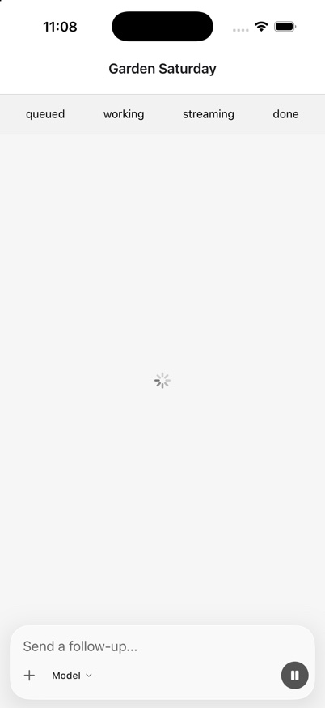
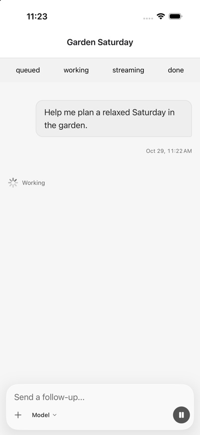
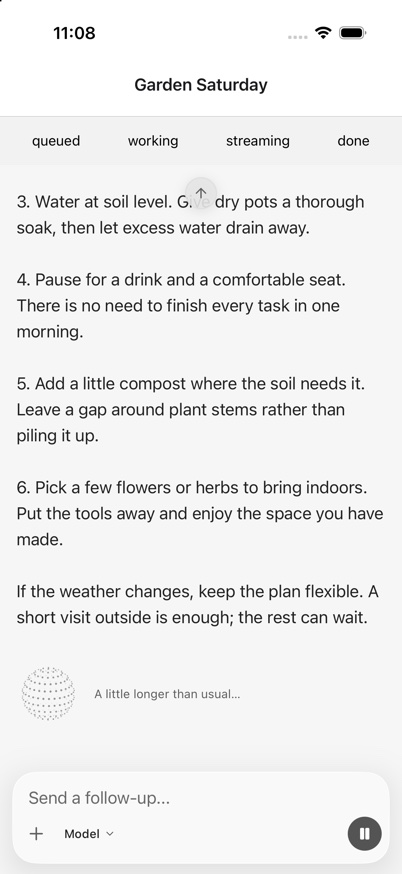
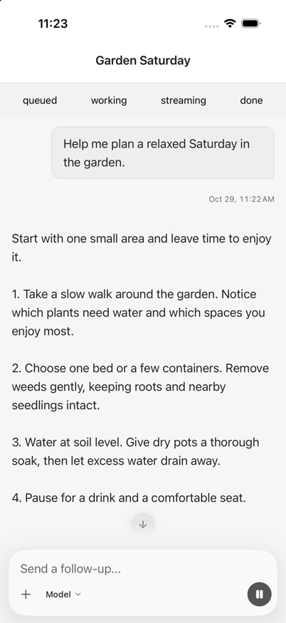
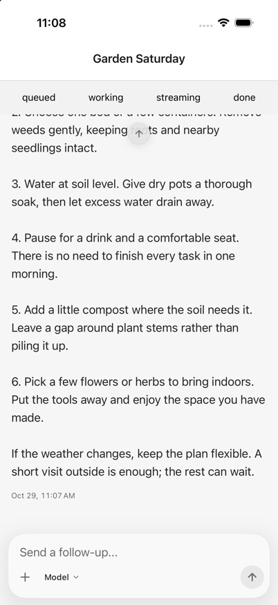
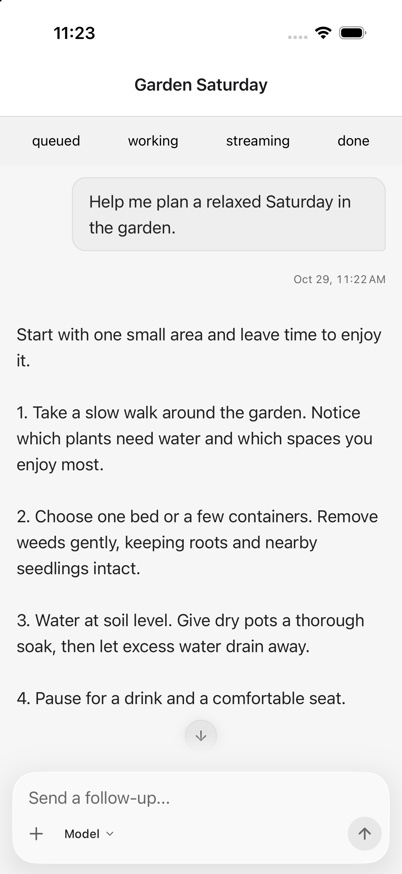

# Native chat: read the answer from its beginning

## Changes

- Timeline navigation has a reserved 44-point lane above the composer, outside the scrolling text. The composer's occupied space is excluded from the reading viewport; annotation and inline-input positioning use that actual viewport.
- The latest prompt anchors a growing answer. A manual scroll releases that anchor; Jump to latest explicitly follows the tail. UIKit's programmatic momentum-completion events cannot change the person's follow intent. Pending-to-durable prompt replacement waits for the new row's layout instead of briefly jumping to the end.
- A display-only, account-client-scoped handoff carries the just-submitted first prompt and attachments across route navigation until durable history is ready. The native screen uses the existing shared startup timeline, not a second queue model. Nothing is resent or persisted by this handoff.
- Native startup uses one plain “Working” indicator. Web and native share the existing useful-output predicate, so startup decoration disappears on the first text, reasoning, or tool activity rather than competing with the reply. Failed preparation and expanded work details remain available. Host-provided loading copy and renderers remain supported.
- New-chat privacy reflects the server's default until the person chooses otherwise. Drafts and create requests preserve an explicit Workspace choice even when the workspace default is private. This corrects the actual choice as well as the chip; it does not change server authorization or visibility policy.
- Both native composers offer a plain Model control. The existing picker, selected model, reasoning effort, latency settings, and policy updates are unchanged.

No worker, provider, prompt assembly, tool schema, model-facing description, history projection, or model-input ordering is changed. The public API snapshot adds only two shared presentation helpers.

## Rendered verification

Captured in an iPhone 17 Pro Simulator on iOS 26.5, using the actual `NativeSessionScreen`, timeline, and composer with a deterministic controller. The small queued/working/streaming/done strip belongs to the local verification fixture, not the product. These are renderer checks, not live-provider journeys; no model requests were made. The fixture uses the same simple Model slot on both sides, so the images do not claim to demonstrate the app's model-picker or privacy changes; those are covered by source review and hook tests.

| State | Before | After |
| --- | --- | --- |
| First history still loading |  |  |
| Long reply streaming |  |  |
| Reply complete |  |  |

Also exercised Jump to latest, Back to your message, manual scrolling followed by a new layout, keyboard presentation, and dark appearance with larger text. The fixture does not exercise live network recovery, provider streaming transport, or persisted app-account navigation.

## Automated regression coverage

- Native renderer: first-output startup dismissal, answer-start anchoring, pending-layout handoff, programmatic versus reader momentum, manual-scroll release, and send-to-resume.
- Shared startup: first-message handoff through durable history and retention of attachment references.
- Native reading offsets: short content, long attachments, and explicit tail following.
- Privacy: server default, explicit Workspace, draft restoration, reset, and unavailable private-chat choices.
- Existing native human-input/stuck-screen and shared startup tests remain in the targeted checks.
